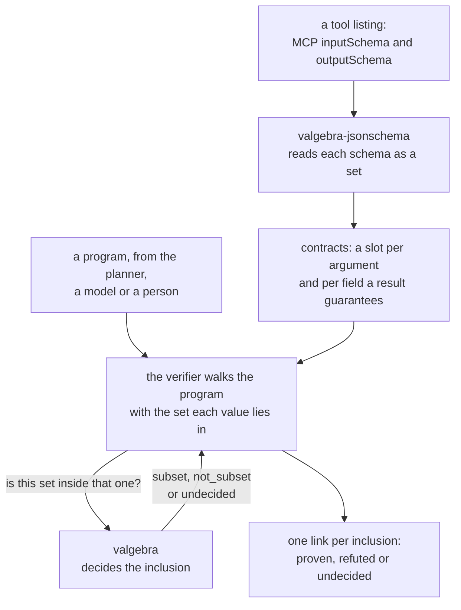
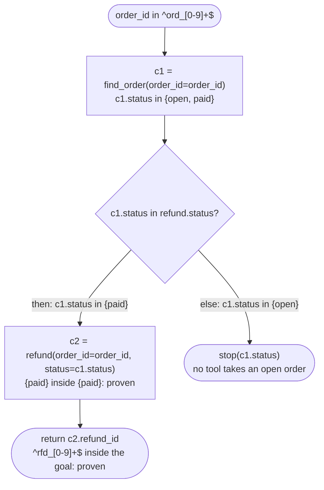
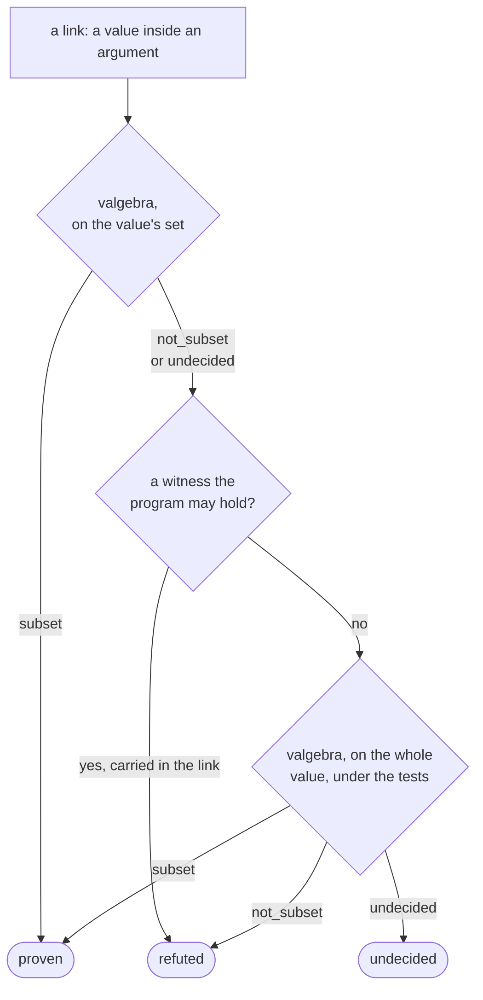
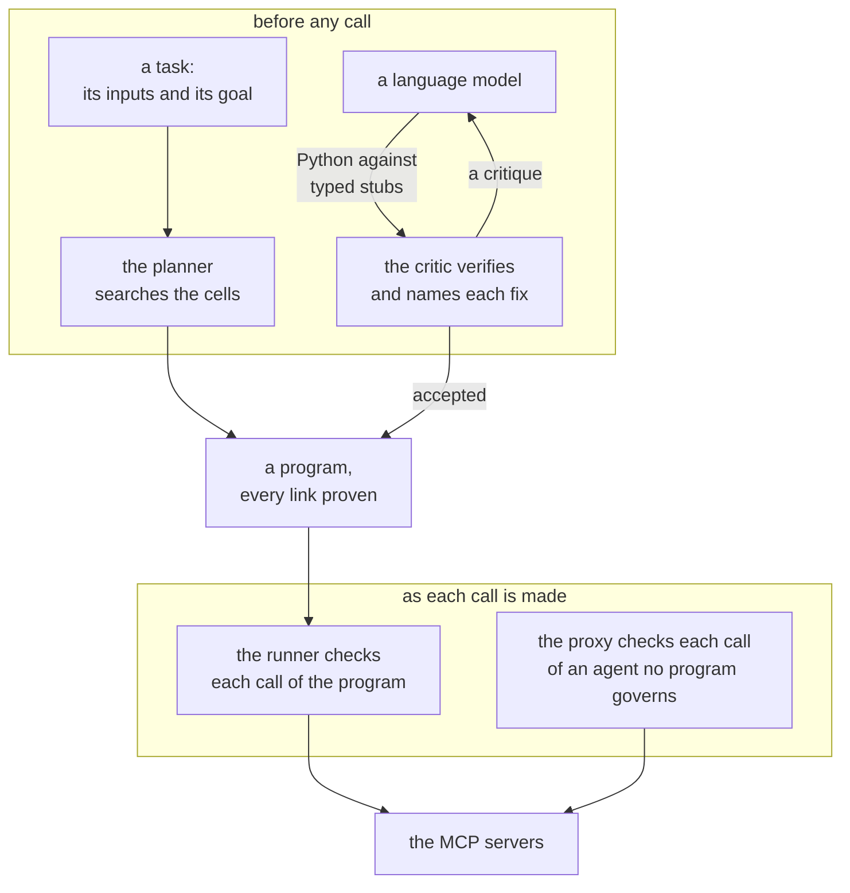

# How it works

A program of tool calls is accepted where valgebra proves every value it passes inside the
argument it fills, and every rule it is held to, for every output the tools' schemas admit, and
where no path of it stops. This page builds that sentence from a tool's contract up;
[the method](method.md) states each part in full.

## The question a program rests on

An agent calls a tool, reads a field of the result and passes it to the next tool. The first
tool's output schema bounds what the field may hold; the second's input schema says what the
argument takes. The call is safe for every answer the first tool may give exactly when the
first set lies inside the second: an inclusion between two sets. A run tries one value of the
first set; the inclusion covers all of them.

`find_order` returns a `status` in `{"open", "paid"}`, and `refund` takes a `status` in
`{"paid"}`. `{"open", "paid"}` does not lie inside `{"paid"}`, and `"open"` is the value that
shows it: a program passing the status straight on is refuted on it, before any call is made,
as [the home page's example](index.md) prints.

## Three packages, one question each



Each package owns one meaning, and none guesses at another's:

| question | owner |
|---|---|
| what a JSON Schema keyword admits | [valgebra-jsonschema](https://ppigazzini.github.io/valgebra-jsonschema/) |
| what a set holds, and whether one lies inside another | [valgebra](https://ppigazzini.github.io/valgebra/) |
| which value reaches which argument, on which path, under which rule | valgebra-planning |

valgebra answers an inclusion `subset`, `not_subset` or `undecided`. A relation it cannot
decide stays undecided here: it can cost a program, and it never admits a wrong one.

## A program is a plan over outputs it does not choose

A tool's output is the one thing a program does not choose: the output schema bounds it, and
any value inside may come back. A plan for such a world is a program of calls and tests, and it
is strong when every path ends with the goal reached, whatever the outcomes (Cimatti et al.
2003). A test is an observation (Bertoli et al. 2006): on each branch the program knows more
about the value it tested.



The planner finds this program itself, and every link of it is proven. It is not strong: the
`else` path stops, and the stop names what it leaves uncovered, an order whose status is
`"open"`, which no tool of the library refunds.

```python
from valgebra_planning.contracts import read_contract, read_task
from valgebra_planning.planner import plan
from valgebra_planning.program import render
from valgebra_planning.verify import verify


def tool(name, takes, returns):
    """Return the contract of a tool listed with these properties, every one required."""
    return read_contract(
        {
            "name": name,
            "inputSchema": {"type": "object", "properties": takes, "required": [*takes]},
            "outputSchema": {"type": "object", "properties": returns, "required": [*returns]},
        }
    )


ORDER = {"type": "string", "pattern": "^ord_[0-9]+$"}
REFUND = {"type": "string", "pattern": "^rfd_[0-9]+$"}
tools = {
    "find_order": tool("find_order", {"order_id": ORDER}, {"status": {"enum": ["open", "paid"]}}),
    "refund": tool(
        "refund",
        {"order_id": ORDER, "status": {"type": "string", "const": "paid"}},
        {"refund_id": REFUND},
    ),
}
task = read_task("refund an order", {"order_id": ORDER}, REFUND)

found = plan(tools, task)
print(render(found.program))
print("strong:", found.strong, "| uncovered:", [(u.ref, u.examples) for u in found.uncovered])
for link in verify(found.program, tools, task).links:
    print(f"{link.where or 'top':5}{link.verdict:9}{link.claim}")
```

```text
c1 = find_order(order_id=order_id)
if c1.status in refund.status:
    c2 = refund(order_id=order_id, status=c1.status)
    return c2.refund_id
else:
    stop(c1.status)
strong: False | uncovered: [('c1.status', ('open',))]
top  proven   order_id <= find_order.order_id
then proven   order_id <= refund.order_id
then proven   c1.status <= refund.status
then proven   return c2.refund_id <= goal
```

## What the verifier carries: a set per value

The verifier walks a program once, holding for each value the set it lies in at that point:
its belief there (Bertoli et al. 2006).

- **A call's result** enters as the tool's output set, a loop's item as its array's item set.
- **A test** narrows the value it tests: to the meet with the tested set on its `then` branch,
  and to the meet with the complement on its `else` branch.
- **A field** below a value is read where valgebra proves every value held there an object
  holding its key: the schema requires it, a test `if "note" in c1.parcel:` shows it, or
  another keyword of the record's schema requires it (Castagna 2023).

At each step that rests on an inclusion, the verifier adds a link and asks valgebra:

| a program | rests on |
|---|---|
| passes a value to an argument | the value's set inside the argument's |
| writes a constant into an argument | the constant a member of the argument's set |
| calls a tool whose input schema relates its arguments | the record of the arguments inside the input set |
| returns a value | the value's set inside the goal |
| passes a value a flow rule watches to its sink | the value's set inside the endorsed set |
| ends a path under a policy | no bad or pending state of the policy reached |

## Three verdicts, one link at a time



- **Proven**: valgebra proves the inclusion for every value the contracts and the tests on the
  way admit.
- **Refuted**: valgebra proves some such value lies outside, or a concrete value it proves the
  program may hold there lies outside; the link carries that value where there is one.
- **Undecided**: neither. The program is not accepted, and the link says so rather than
  guessing.

A field's declared schema may admit more than its record allows, as where an `allOf` narrows
it, so the last question is asked of the value the field belongs to, and a loop's item of the
value holding its array. A program is accepted, `Verification.proven`, when every link is
proven and no path stops.

## Where a program comes from, and where it runs



- **The planner** cuts every slot, input and goal into cells, the minterms of their predicates
  within each kind of JSON value, and searches calls and tests over them, shallowest program
  first, then a weak one whose stops name what they leave uncovered.
- **The critic** verifies a program written elsewhere and returns each link not proven, the value
  refuting it and what to change: the test that makes a call safe, the call a policy needs
  first, the error block a call needs. A language model proposes and a sound critic checks
  (Kambhampati et al. 2024); `repair` hands each critique back until a program is accepted or
  the rounds run out. [Code mode](code-mode.md) is that loop.
- **The runner** calls the tools a program names and checks each step as it is made. A proof
  holds over the contracts, so the case a run must not pass on is a server answering outside its
  own contract: the run ends, closed, naming the check.
- **The proxy** stands in front of an MCP server for an agent no program governs, and answers a
  call breaking a check with a tool error naming it.

## A proof and a run

| | checks | when |
|---|---|---|
| `verify`, `critique` | every value the contracts admit | before any call |
| `run` | the values of one run: each argument record, result, policy step and the returned value | as each call is made |
| the proxy | each call an agent makes: its arguments, its result, the policies and the flow rules | as each call is made |

A run that breaks no check shows the values it met. A verified program holds for every value the
contracts admit, and a run beside it shows the servers keep those contracts.

## Rules beyond types

A program is held to more than the types its values carry, each rule asked as sets the same way
([the rules](method.md#rules-a-program-is-held-to)):

- **Errors.** Where any tool may answer with an error, a call is retried only where its
  tool's annotations say it is read-only or idempotent; any other call needs an error block.
- **Policies.** An automaton over the calls, whose guards are sets of argument records: a path
  that surely reaches a bad state, or ends in a pending one, an obligation left open, is
  refuted, and one that possibly does is undecided.
- **Flows.** A value from a source the rule names reaches its sink only inside the set the rule
  endorses. With `only` the rule holds every other origin instead: the sink takes a value from
  its sources on every path, and anything else only inside the endorsed set.

## Where it sits

CaMeL (Debenedetti et al. 2025) runs a model's plan in an interpreter that records where each
value came from and checks a policy before each call; FIDES (Costa et al. 2025) labels each
value's integrity and confidentiality in the planner; Progent (Shi et al. 2025) allows each
tool's calls by a privilege policy. Each checks a call as the agent makes it. valgebra-planning
asks Progent's question and the integrity half of the others of the whole program before it
runs, as privilege policies and flow rules over sets, for every output the contracts admit; its
runner and proxy ask them again of each call made.

## What it does not cover

- **The types are the specification.** A slot whose schema admits any string takes any
  string: distinct patterns, enums and ranges are what make a proof mean what its author wants.
- **Effects are the policies'.** A call can act on the world, and no effect is modeled beyond
  the calls a policy reads.
- **A gap is reported, never filled.** A relation valgebra leaves undecided, a keyword the
  companion cannot read, a stop no tool covers: each is named where it falls.

The full list is [the limits](method.md#limits).
